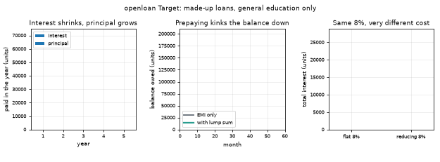
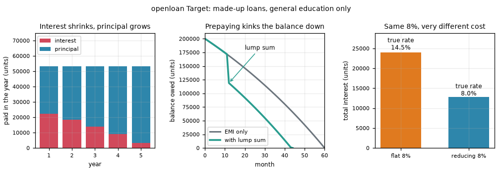
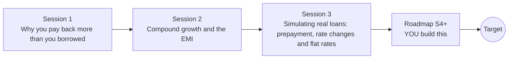

# openloan

[](https://github.com/KrunalPanchal1995/openloan/actions/workflows/ci.yml)   [](https://colab.research.google.com/github/KrunalPanchal1995/openloan/blob/main/sessions/session-01/lesson.ipynb) [](https://krunalpanchal1995.github.io/openloan/)

**Compare loan EMIs and see how interest compounds, in three sessions.**

openloan teaches how loans really work, from simple versus compound interest to EMIs, amortisation, prepayment and the hidden cost of flat rates, using only Python and a browser.

- **Start from zero.** Session 1 needs only school arithmetic and percentages.
- **See it move.** Every session ships a slider app that runs in the browser, with labelled graphs.
- **Know you got it right.** Each session ends with a checkpoint that prints PASS or FAIL against hand calculations.
- **Build the missing half.** The repo stops at Session 3 on purpose; the roadmap shows the path to the Target.

[Target](#the-target) · [Who is this for](#who-is-this-for) · [Quick start](#quick-start) · [Sessions](#sessions) · [Roadmap](#roadmap) · [Contribute](#contribute) · [Explainer PDF](docs/explainer.pdf)

> **This repo is incomplete on purpose.** Sessions 1 to 3 are here and fully working. The finished Target below is a preview of what the community can build next. We show you the path, not the code. Sessions 4 and up are yours.

## The Target

Three linked pictures of one made-up loan. First, a stack of interest and principal that shifts over the years: early payments are mostly interest, late payments mostly principal. Second, the balance curve with a kink where a lump sum is paid early. Third, a 'flat 8 percent' offer next to a 'reducing 8 percent' one: the flat offer costs almost twice the interest and its true rate is about 14.5 percent. Your goal over the coming sessions: build all three yourself and let a user choose the loan.



*Target: the interest and principal stack, a prepayment kink and flat versus reducing cost*



*Target, final frame*

Try it live:

- [Math Visual Studio (Studio root)](https://krunalpanchal1995.github.io/studio/)

How the Target was made is shown only as a path in [promo/roadmap.md](promo/roadmap.md).

## Who is this for
**secondary school to diploma / undergraduate (levels 3-5).** Topic area: Economics, Business, Finance and Entrepreneurship.

Prerequisites:

- Percentages and powers (like 1.1 x 1.1 x 1.1), school level.
- Python 3.10 or newer; if `python --version` works, you are ready. PRIMER.md explains the rest.
- No prior GitHub or finance experience is needed. All lenders and rates here are made up; this is general education, not financial advice.

New to Python? Read [PRIMER.md](PRIMER.md) first (10 minutes).

## Quick start

No installation knowledge needed. You need [Git](https://git-scm.com/downloads) and [Python 3.10+](https://www.python.org/downloads/) (Windows: tick "Add Python to PATH"). On Mac and Linux type `python3` wherever this page says `python`.

```bash
git clone https://github.com/KrunalPanchal1995/openloan.git
cd openloan
python start.py 1
```

`start.py` creates a private environment, installs what is needed and runs Session 1 with its checkpoint. Next: `python start.py 2`, `python start.py 3`, or `python start.py test` to check everything. Only a checkpoint: `python start.py check 1`.

Four lines turn the idea of Session 2 into a result (they work as they are): Save it as `try.py` and run it with `python start.py run try.py` (this uses the private environment, where NumPy is installed):

```python
import numpy as np
P, r, n = 100000, 0.12 / 12, 24                 # borrow 100000, 1 percent a month, 24 months
emi = P * r * (1 + r) ** n / ((1 + r) ** n - 1)  # the EMI formula
print(round(emi, 2))                             # -> 4707.35 paid every month
```

Every session also opens in your browser with sliders (no install): [live apps](https://krunalpanchal1995.github.io/openloan/). Or use the Colab badge above for the notebook.

## Sessions

| # | Session | Model level | Time | Live app |
|---|---|---|---|---|
| 1 | [Why you pay back more than you borrowed](sessions/session-01/README.md) | Level 1: conceptual interactive model | 60 min | [open](https://krunalpanchal1995.github.io/openloan/session-01/) |
| 2 | [Compound growth and the EMI](sessions/session-02/README.md) | Level 2: mathematical engineering model | 75 min | [open](https://krunalpanchal1995.github.io/openloan/session-02/) |
| 3 | [Simulating real loans: prepayment, rate changes and flat rates](sessions/session-03/README.md) | Level 3: simulation and validation | 90 min | [open](https://krunalpanchal1995.github.io/openloan/session-03/) |

Each session follows the same six steps: A real-world problem, B concept and theory, C visual explanation, D interactive simulation, E worked example and experiment, F assessment and design challenge. Each ends with `checkpoint.py`, which prints `PASS` or `FAIL` against reference numbers. Session 3 also contains the real-world mini-project: **Compare three made-up loan offers**.

## Architecture



| Folder or file | What is inside |
|---|---|
| `sessions/` | three sessions: README (A-F), `lesson.py`, notebook, live app, exercises, activity sheet, checkpoint |
| `promo/` | the Target: media, live links, and the roadmap (path only) |
| `docs/` | `explainer.tex` and the built `explainer.pdf` |
| `tests/` | runs every lesson and checkpoint headless |
| `start.py` | one command to set up and run anything |
| `QUALITY.md`, `RUBRIC.md` | the quality checklist and the scoring rubric |
| `.github/` | CI, PDF build, Pages deploy, issue and PR templates |

## Roadmap

| Milestone | What you will build | Difficulty |
|---|---|---|
| Session 4: All-in cost with extra charges | A function returning the effective annual rate of a loan with a percentage fee and a fixed insurance amount, both deducted from the money received. | intermediate |
| Session 5: Step-up EMI | A solver for the first-year EMI when the payment rises 5 percent every 12 months and the balance must end at zero. | intermediate |
| Session 6: Prepayment penalty optimiser | A search over lump-sum months with a 2 percent penalty on the lump sum. | intermediate |
| Session 7: Rate path engine | A simulator that takes a list of rates and recomputes the EMI every 6 months. | advanced |
| Session 8: Reproduce the Target | A 48-frame animation with three linked panels, saved as a GIF under 3 MB. | advanced |

Full detail with a checkpoint per milestone: [promo/roadmap.md](promo/roadmap.md).

## Contribute
New to GitHub? Read [CONTRIBUTING.md](CONTRIBUTING.md); it starts from zero. Pick an issue labelled `good first issue`. Translations into Hindi, Telugu, Tamil and Malayalam are welcome.

<details>
<summary>Development</summary>

```bash
python start.py test        # runs every lesson and checkpoint
```
Lessons use `# %%` cell markers so they open as notebooks in VS Code. See [QUALITY.md](QUALITY.md) for the standard every session meets.
</details>

## License
MIT. See [LICENSE](LICENSE). Media in `promo/media` is (c) Krunal Panchal, CC BY 4.0.

## Acknowledgments
Part of the [PAN IIT OSS](https://hellofoss.tech-iitb.org/projects) open-source teaching collection, modelled on the structure of [openspline](https://github.com/openspline/openspline). Built on ideas from the Math Visual Studio at https://krunalpanchal1995.github.io/studio/.
