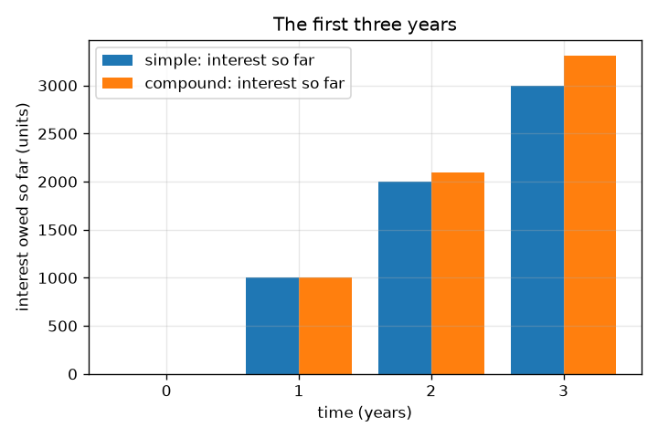
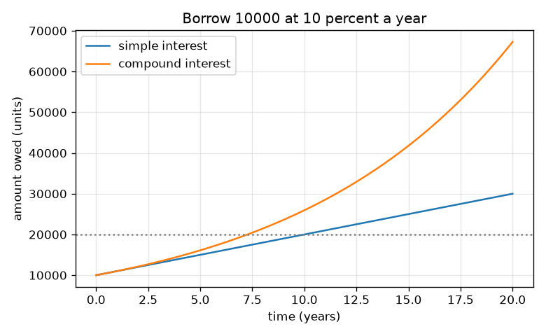

# Session 1: Why you pay back more than you borrowed

*Level 1 (conceptual interactive model) · about 60 minutes · openloan*

> This is a simplified educational model. It is not a validated design tool and must not be used for real structures, electrical installations, vehicles, industrial processes or medical decisions.

**Prerequisites**

- Percentages and simple multiplication.
- You have read PRIMER.md and run `python start.py 1` once.

**Learning objectives.** After this session you can:

- Explain interest as the price of using someone else's money.
- Compute the amount owed with simple interest and with compound interest.
- Explain why compound interest grows faster than simple interest.
- Read a graph of amount owed against time.

## A. Real-world problem
A friend lends you 10000 units today and wants only 10000 back. A bank charges interest: you will pay back more than you borrowed. How much do you owe after 3 years if the interest is 10 percent a year? And why does a debt that adds interest to itself grow faster and faster? This repo is general education with made-up lenders and rates; it is not financial advice.

## B. Concept and theory
The principal P is the amount borrowed. The rate r is the yearly interest as a fraction (10 percent is 0.10). With simple interest the lender charges r P every year on the original P only, so after t years you owe A = P (1 + r t). With compound interest each year's interest is added to the debt, so the next year's interest is charged on a bigger amount: the debt is multiplied by (1 + r) every year and after t years you owe A = P (1 + r)^t. After one year the two are equal; after that compound interest is larger. Simple interest grows along a straight line, compound interest along a curve that bends upwards.

| Symbol | Meaning | Unit |
|---|---|---|
| P | principal: the amount borrowed | units (any currency) |
| r | interest rate per year as a fraction (0.10 = 10 percent) | per year |
| t | time | years |
| A | amount owed after t years | units |

**Assumptions**

- Nothing is repaid until the end.
- The rate stays the same for the whole time.
- Interest is added once a year in the compound case.
- All lenders and rates are made up.

$$ A_{\text{simple}}=P\,(1+r\,t) $$

$$ A_{\text{compound}}=P\,(1+r)^{t} $$

$$ t_{\text{double, simple}}=\frac{1}{r},\qquad t_{\text{double, compound}}=\frac{\ln 2}{\ln(1+r)} $$

## C. Visual explanation
The first figure plots the amount owed against time for 10000 units at 10 percent: simple interest is a straight line, compound interest bends upwards, and after 20 years they are 30000 and 67275. The second figure shows the interest owed in each of the first three years as bars: the two methods agree in year 1 and drift apart afterwards (12000 against 12100 after 2 years, 13000 against 13310 after 3).

*Interest owed in the first three years: equal in year 1, then compound pulls ahead.*

*Amount owed over 20 years at 10 percent: a straight line against a curve.*

## D. Interactive simulation
Run the lesson (`python start.py 1`), then open the live app: [Session 1: simple versus compound interest](https://krunalpanchal1995.github.io/openloan/session-01/) (or `app.html` in this folder). Move the principal, rate and years sliders. In the bar view compare the two bars, then in the graph view see the straight line and the curve separate.

**Challenge.** Find a setting where compound interest costs at least 2000 units more than simple interest.

## E. Worked example and experiment
**Problem.** You borrow 10000 units at 10 percent a year for 3 years and repay everything at the end. How much do you owe with simple interest and with compound interest, and what is the difference?

1. Simple: interest = 10000 * 0.10 * 3 = 3000, so you owe 10000 + 3000 = 13000.
2. Compound, year 1: 10000 * 1.1 = 11000.
3. Year 2: 11000 * 1.1 = 12100. Year 3: 12100 * 1.1 = 13310. (Or 10000 * 1.1^3 = 13310.)
4. Difference = 13310 - 13000 = 310 units: the interest charged on earlier interest.

**Answer.** Simple interest: 13000 units. Compound interest: 13310 units. Compounding costs 310 more.

**Experiment.** Use a calculator or spreadsheet: start with 10000 and multiply by 1.1 three times, writing down each result; compare with 10000 + 3 * 1000. Real lenders add details this model leaves out (fees, daily interest, rounding, rates that change), so a real statement will differ slightly from the model. The model is exact for its own assumptions; reality has more of them.

## F. Assessment and design challenge
**Question type A: Conceptual.** Why does compound interest grow faster than simple interest, even though both use the same rate? When are they equal?

Hint

Ask what the interest is charged on in the second year.

Step-by-step solution

With simple interest the interest is always charged on the original principal. With compound interest last year's interest has been added to the debt, so this year's interest is charged on a larger amount: interest on interest. They are equal after exactly one year (and at time zero); from year 2 onwards compound is larger.

**Question type B: Numerical.** You borrow 5000 units at 8 percent a year for 2 years. Find the amount owed with simple and with compound interest. Check that your answers are sensible.

Hint

Simple: 5000 (1 + 0.08 * 2). Compound: 5000 * 1.08 * 1.08.

Step-by-step solution

Simple: 5000 * 1.16 = 5800 units. Compound: 5000 * 1.1664 = 5832 units. Sanity check: both exceed 5000, compound is slightly larger than simple, and the difference (32 units) is 5000 * 0.08^2, the interest on the first year's interest.

**Question type C: Graph and simulation interpretation.** In the graph for 10000 units at 10 percent, what are the amounts owed after 20 years, and what does the widening gap between the curves tell you?

Hint

Read the two curves at 20 years on the horizontal axis.

Step-by-step solution

Simple interest gives 30000 units, compound gives about 67275 units. The gap keeps widening because simple interest adds the same slice each year while compound interest adds a slice that grows with the debt. Long debts are where compounding matters most.

**Question type D: Design and optimisation challenge.** Design: a friend offers 10000 units for 5 years at 12 percent simple interest. A bank offers the same loan at 10 percent compound. Which is cheaper over 5 years? Would your answer change at 20 years?

Hint

Compute both amounts for 5 years, then think about which curve bends upwards.

Step-by-step solution

Friend: 10000 * (1 + 0.12 * 5) = 16000 units. Bank: 10000 * 1.1^5 = 16105.10 units. Over 5 years the friend's offer is cheaper, by about 105 units, although its rate is higher. Assumption: nothing is repaid before the end and no fees. Over much longer times the compound curve bends upwards and eventually passes any straight line, so the answer can reverse. The lesson: compare the total amount over the time you will really borrow, not the headline rate.

Score yourself with [RUBRIC.md](../../RUBRIC.md). Print the [activity sheet](activity_sheet.md) to work on paper.

## Common misconceptions
| Common misconception | What is actually true |
|---|---|
| Interest is a fixed amount that does not depend on how long you borrow. | Interest grows with time; the longer you owe, the more you pay. |
| 10 percent a year for 3 years means 30 percent more. | That is only true for simple interest (3000 on 10000). With compounding it is 3310 on 10000, because each year's interest is added to the debt. |
| Compound interest is always much bigger than simple interest. | In year 1 they are equal and for short loans the difference is small; it becomes large for long times and high rates. |

## Glossary
- **principal**: the amount borrowed
- **interest**: the price paid for using borrowed money
- **simple interest**: interest charged only on the original principal
- **compound interest**: interest charged on the principal plus interest already added
- **rate**: interest per year as a percentage or fraction of the principal

## Finish
1. Do the three coding tasks in [exercises.md](exercises.md).
2. Run `python start.py 1` again after your changes. It ends with the checkpoint; when it prints `PASS`, you are done. (Checkpoint only: `python start.py check 1`.)

Next: [Session 2](../session-02/README.md)
