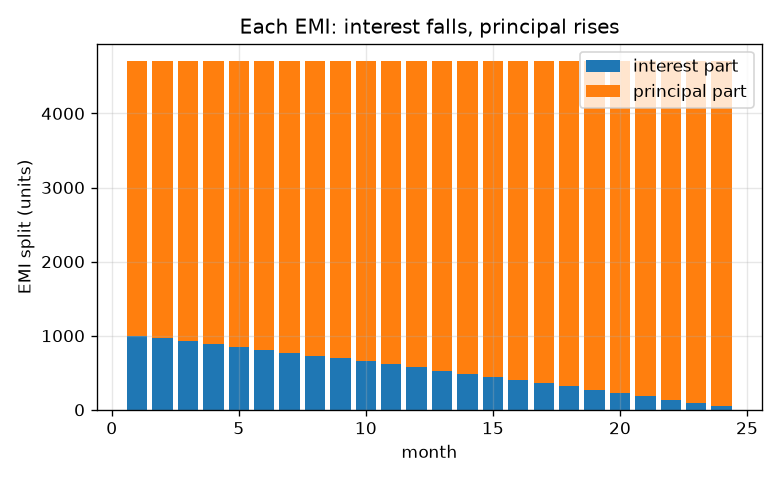
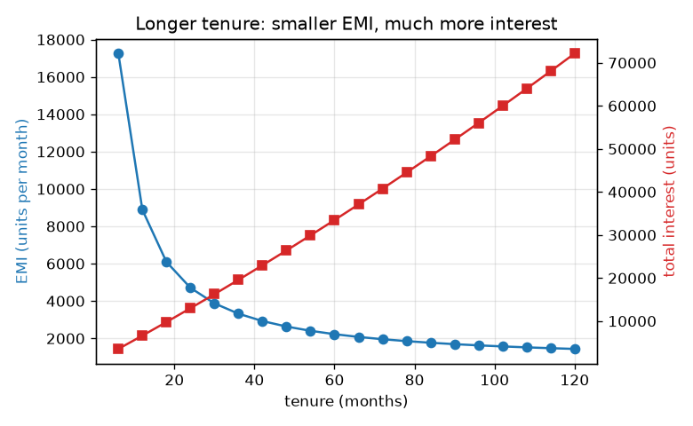

# Session 2: Compound growth and the EMI

*Level 2 (mathematical engineering model) · about 75 minutes · openloan*

> This is a simplified educational model. It is not a validated design tool and must not be used for real structures, electrical installations, vehicles, industrial processes or medical decisions.

**Prerequisites**

- Session 1: simple and compound interest.
- Powers and exponents; a calculator or Python.

**Learning objectives.** After this session you can:

- Use A = P (1 + r/n)^(n t) and see the continuous-compounding limit.
- Compute the EMI from the formula and verify it by simulating the balance month by month.
- Read an amortisation schedule: interest part falls, principal part rises.
- Compare loans by total cost, tenure and effective annual rate.

## A. Real-world problem
Most loans are paid back in equal monthly instalments, the EMI (equated monthly instalment). Where does that number come from? How much of each payment is interest? Why does stretching a loan to make the EMI smaller cost so much more in the end? And of two offers with different rates and fees, which one is cheaper? General education with made-up offers; not financial advice.

## B. Concept and theory
If interest is added n times a year, A = P (1 + r/n)^(n t). Raising n makes A grow, but only up to the limit P e^(r t) (continuous compounding). For a loan repaid in n months at the same instalment E, with monthly rate i = annual rate / 12, the balance after each month is balance x (1 + i) - E. Choosing E so that the balance reaches exactly zero after n months gives EMI = P i (1+i)^n / ((1+i)^n - 1). Month k's interest part is balance x i and its principal part is E minus that. Total interest = n E - P. The effective annual rate (1 + i)^12 - 1 is what the monthly compounding really costs over a year.

| Symbol | Meaning | Unit |
|---|---|---|
| P | principal: the amount borrowed | units |
| i | monthly rate = annual rate / 12 | per month |
| n | number of monthly payments (tenure) | months |
| E | EMI: the equal monthly payment | units per month |
| A | amount after compounding | units |
| r, t | annual rate (fraction) and time in years for compound growth | per year, years |

**Assumptions**

- Payments are made at the end of each month.
- The monthly rate is the annual rate divided by 12.
- The rate stays fixed.
- A one-off fee is a fraction of P paid on top of the interest.
- All lenders and rates are made up.

$$ A=P\left(1+\frac{r}{n}\right)^{nt}\ \longrightarrow\ P\,e^{rt}\quad (n\to\infty) $$

$$ E=\frac{P\,i\,(1+i)^{n}}{(1+i)^{n}-1},\qquad i=\frac{\text{annual rate}}{12} $$

$$ B_{k}=B_{k-1}(1+i)-E,\qquad B_0=P,\ B_n=0 $$

$$ \text{interest}_k=B_{k-1}\,i,\qquad \text{principal}_k=E-\text{interest}_k,\qquad \text{total interest}=nE-P $$

$$ \text{effective annual rate}=(1+i)^{12}-1 $$

## C. Visual explanation
The first figure stacks each month's EMI into its interest part and principal part for a 24-month loan: the interest part shrinks from 1000.00 in month 1 to 46.61 in month 24 while the principal part grows from 3707.35 to 4660.74, and the total stays 4707.35. The second figure plots EMI and total interest against tenure: EMI falls and flattens, total interest keeps rising.

*Each EMI split into interest and principal over 24 months.*

*EMI and total interest against tenure for 100000 at 12 percent.*

## D. Interactive simulation
Run the lesson (`python start.py 2`), then open the live app: [Session 2: the EMI and the amortisation schedule](https://krunalpanchal1995.github.io/openloan/session-02/) (or `app.html` in this folder). Change the loan, rate and tenure sliders. In the split view watch the red interest part fall and the blue principal part rise; in the tenure view see how the total interest climbs with a longer tenure.

**Challenge.** Borrow at least 100000 units with an EMI of at most 3500 and total interest of at most 20000.

## E. Worked example and experiment
**Problem.** Borrow 100000 units at 12 percent a year for 24 months. Find the EMI, the interest and principal of month 1, and the total interest, then check the EMI by simulating the balance.

1. Monthly rate i = 12 / 12 percent = 0.01 and n = 24. (1.01)^24 = 1.2697.
2. EMI = 100000 * 0.01 * 1.2697 / (1.2697 - 1) = 1269.7 / 0.2697 = 4707.35 units.
3. Month 1: interest = 100000 * 0.01 = 1000.00; principal = 4707.35 - 1000.00 = 3707.35.
4. Total interest = 24 * 4707.35 - 100000 = 12976.33 units.
5. Check by simulation: start at 100000; each month multiply by 1.01 and subtract 4707.35. After 24 months the balance is 0 (to rounding).

**Answer.** EMI 4707.35 units per month; month 1 has 1000.00 interest and 3707.35 principal; total interest 12976.33 units; the simulated balance reaches zero after 24 payments.

**Experiment.** Build the same table in a spreadsheet: one row per month with columns balance, interest, EMI, new balance. Compare the last balance with zero and with the checkpoint output. A real lender's statement may differ by a few units because of rounding each payment to whole units, a different day count, or a first payment that is not exactly one month away. The model assumes perfectly equal months.

## F. Assessment and design challenge
**Question type A: Conceptual.** Why is the interest part of the EMI large at the start and small at the end, although the EMI itself never changes?

Hint

What is the interest in a month charged on?

Step-by-step solution

Interest each month is charged on the balance still owed. Early on the balance is large, so the interest part is large and little of the EMI is left to reduce the balance. Each payment lowers the balance, so the next interest part is smaller and more of the fixed EMI goes to principal. In the example the interest part falls from 1000.00 to 46.61 while the principal part rises from 3707.35 to 4660.74.

**Question type B: Numerical.** Find the EMI and the total interest for 100000 units at 12 percent a year over 12 months. State the units and do a sanity check.

Hint

Use i = 0.01 and n = 12 in the EMI formula; total interest = n E - P.

Step-by-step solution

EMI = 8884.88 units per month. Total interest = 12 * 8884.88 - 100000, which is about 6618.55 units. Sanity check: the average balance is about half of 100000, so interest is about 12 percent of 50000 = 6000, close to the exact 6618.55.

**Question type C: Graph and simulation interpretation.** In the tenure graph for 100000 units at 12 percent, what happens to the EMI and to the total interest when the tenure grows from 12 to 60 months?

Hint

Compare the table values at 12 and at 60 months.

Step-by-step solution

The EMI falls from 8884.88 to 2224.44 units, about a quarter of the size, but the total interest rises from 6618.55 to 33466.69 units, more than five times as much. A longer tenure lowers the monthly burden but you pay interest on the balance for much longer.

**Question type D: Design and optimisation challenge.** Design: you can afford an EMI of at most 4000 on a 100000 loan at 12 percent and want the least total interest. Which tenure in the table (12, 24, 36, 48 or 60 months) do you pick? Separately, compare Offer A (9.0 percent a year with a 2 percent fee, 36 months) and Offer B (9.8 percent, no fee, 36 months) for 100000. Which is cheaper in total?

Hint

Check the EMI at each tenure first. For the offers, total cost = n E - P + fee.

Step-by-step solution

At 24 months the EMI is 4707.35, above 4000, so it fails; 36 months has EMI 3321.43 and total interest 19571.52, the shortest tenure that fits and so the least interest. Offers: A has EMI 3179.97 and total cost 16479.04 (interest plus fee); B has EMI 3217.34 and total cost 15824.13. B is cheaper in total even though its rate is higher and its EMI larger, because A's fee outweighs its lower rate over this tenure. Assumptions: the fee is paid in cash up front, no prepayment, rates fixed.

Score yourself with [RUBRIC.md](../../RUBRIC.md). Print the [activity sheet](activity_sheet.md) to work on paper.

## Common misconceptions
| Common misconception | What is actually true |
|---|---|
| A lower EMI means a cheaper loan. | A lower EMI usually comes from a longer tenure and then the total interest is much higher. |
| Each EMI is half interest and half principal. | The split changes every month: mostly interest at first, mostly principal at the end. |
| 12 percent a year with monthly interest costs exactly 12 percent a year. | Monthly compounding makes the effective annual rate higher: 12.683 percent for a nominal 12 percent. |
| More compounding periods can make the debt grow without limit. | Growth rises towards the limit P e^(r t) and never passes it. |

## Glossary
- **EMI**: equated monthly instalment: the equal amount paid every month
- **tenure**: the length of the loan in months
- **amortisation schedule**: a table of every payment split into interest and principal, with the balance after it
- **effective annual rate**: the yearly rate that includes the effect of compounding within the year
- **continuous compounding**: the limit of compounding more and more often, A = P e^(r t)

## Finish
1. Do the three coding tasks in [exercises.md](exercises.md).
2. Run `python start.py 2` again after your changes. It ends with the checkpoint; when it prints `PASS`, you are done. (Checkpoint only: `python start.py check 2`.)

Next: [Session 3](../session-03/README.md)
