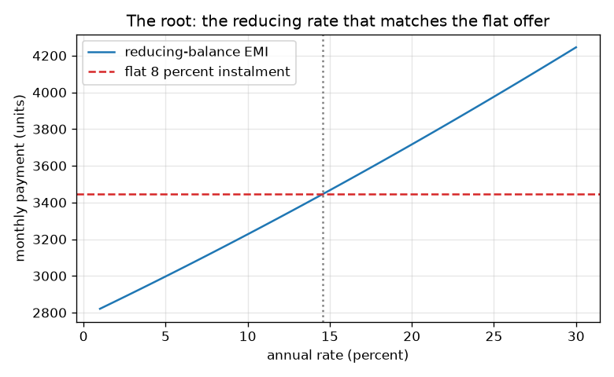
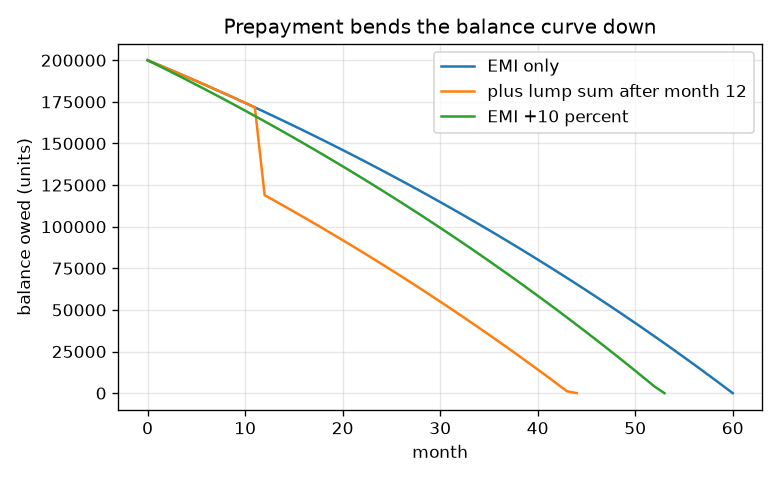

# Session 3: Simulating real loans: prepayment, rate changes and flat rates

*Level 3 (simulation and validation) · about 90 minutes · openloan*

> This is a simplified educational model. It is not a validated design tool and must not be used for real structures, electrical installations, vehicles, industrial processes or medical decisions.

**Prerequisites**

- Session 2: the EMI formula and the amortisation schedule.
- Loops and functions in Python.

**Learning objectives.** After this session you can:

- Build a month-by-month loan simulator and validate it against the EMI formula.
- Quantify interest saved by a lump-sum prepayment or a slightly higher EMI.
- Find the true rate of a flat-rate loan by root-finding (bisection and Newton).
- Recognise failure cases: unaffordable loans and negative amortisation.

## A. Real-world problem
Real loans are messier than the formula. You may pay extra when you have spare money, the bank may change the rate, an offer of 'flat 8 percent' may sound cheaper than it is, and money loses value with inflation. A simulator can answer all of these. General education with made-up numbers; not financial advice.

## B. Concept and theory
The simulator repeats one step per month: add interest (balance x annual rate / 12), subtract the payment, and subtract any lump sum. It reproduces the EMI formula exactly when nothing else changes, which validates it. A prepayment reduces the balance at once, so every later month's interest is smaller and the loan ends earlier. If the rate changes, either the tenure changes (keep the EMI) or the EMI is recomputed for the remaining months. A flat-rate offer charges rate x P x years of interest on the original amount and splits P plus interest into equal instalments; since you repay principal every month, the true rate is the one for which the reducing-balance EMI equals the flat instalment, found by bisection or Newton's method. Payments in the future are worth less today: the present value of a payment E in month k is E / (1 + inflation/12)^k. Failure cases: an EMI above the share of income you can spare, and a payment below the monthly interest, which makes the balance grow (negative amortisation).

| Symbol | Meaning | Unit |
|---|---|---|
| B_k | balance after month k | units |
| i | monthly rate = annual rate / 12 | per month |
| E | payment each month | units per month |
| L | lump sum paid after month m | units |
| flat | flat annual rate quoted on the original P | per year |
| x | unknown true annual rate to be found | per year |
| infl | yearly inflation | per year |

**Assumptions**

- Interest is added monthly at annual rate / 12 and payments are at the end of the month.
- A lump sum is paid right after that month's EMI and has no penalty.
- In a flat-rate loan nothing is saved by prepaying.
- Inflation is constant.
- All lenders and rates are made up and the model is a simplification, not a tool for real decisions.

$$ B_k=B_{k-1}(1+i)-E-L\,[k=m] $$

$$ E_{\text{flat}}=\frac{P\,(1+\text{flat}\cdot n/12)}{n} $$

$$ f(x)=\text{EMI}(P,x,n)-E_{\text{flat}}=0,\qquad x_{j+1}=x_j-\frac{f(x_j)}{f'(x_j)} $$

$$ PV=\sum_{k=1}^{n}\frac{E}{(1+\text{infl}/12)^{k}} $$

$$ P_{\max}=E_{\max}\,\frac{(1+i)^{n}-1}{i\,(1+i)^{n}},\qquad E_{\max}=\text{income}\times\text{share} $$

## C. Visual explanation
The first figure plots the balance against the month for a 200000 loan at 12 percent over 60 months: the grey curve is the plain loan, the others show a 50000 lump sum after month 12 (a sudden kink down, then a steeper fall) and an EMI raised by 10 percent. The second figure plots the reducing-balance payment against the annual rate for a 100000, 36-month loan; the horizontal line is the flat 8 percent instalment, and where it meets the curve (about 14.5 percent) is the true rate.

*Reducing-balance payment against rate; the flat 8 percent instalment meets it near 14.5 percent.*

*Balance against month: a lump sum after month 12 and a 10 percent higher EMI shorten the loan.*

## D. Interactive simulation
Run the lesson (`python start.py 3`), then open the live app: [Session 3: prepayment simulator](https://krunalpanchal1995.github.io/openloan/session-03/) (or `app.html` in this folder). Move the lump-sum, lump-month and extra-EMI sliders. Watch the balance curve kink and the interest saved change; compare the two bar rows for months and interest.

**Challenge.** Clear the 200000 loan in 40 months or fewer using a lump sum of at most 50000 and an EMI increase of at most 10 percent.

## E. Worked example and experiment
**Problem.** A loan of 200000 units at 12 percent a year over 60 months has an EMI of 4448.89. You pay a lump sum of 50000 after month 12 and keep paying the same EMI. When does the loan end and how much interest is saved? Then find the true rate of a flat 8 percent, 36-month loan of 100000.

1. Without prepayment the simulation ends in 60 months with total interest 66933.37.
2. With the lump sum the balance drops by 50000 at month 12; the simulation ends in 44 months with total interest 42482.30.
3. Interest saved = 66933.37 - 42482.30 = 24451.07 units; the loan ends 16 months early.
4. Flat 8 percent: interest = 100000 * 0.08 * 3 = 24000, instalment = 124000 / 36 = 3444.44.
5. Solve EMI(100000, x, 36) = 3444.44 for x by bisection: x = 14.548 percent a year. A reducing 8 percent loan has EMI 3133.64 and interest 12810.92, just over half of the flat interest.

**Answer.** The loan ends in 44 months and saves 24451.07 units of interest. 'Flat 8 percent' is really about 14.548 percent a year on the reducing balance.

**Experiment.** Put the same loan in a spreadsheet, add a lump-sum column and compare the last month with the simulator. For the flat rate, use a spreadsheet goal-seek or rate function on the instalment. Real lenders may charge a prepayment fee, round payments, restrict lump sums, or move the interest date, so real savings are smaller than the model's. The simulator is exact for its own assumptions only.

## Real-world application and mini-project: Compare three made-up loan offers
You need 300000 units for 60 months. Offer X: 10.5 percent reducing balance with a 1 percent fee. Offer Y: 9.5 percent reducing balance with a 3 percent fee. Offer Z: 'flat 6 percent', no fee. All are made up. For each offer find the EMI or instalment, the total cost (interest plus fee), the effective annual rate when the fee is taken out of the money you receive, and the interest saved by a 50000 lump sum after month 12 (assume Z allows no benefit). Use `simulate`, `emi`, `flat_instalment` and `true_annual_rate_bisect` from Session 3. General education only, not advice.

**Deliverable:** A script that prints a table of the three offers with the four numbers above and names the cheapest offer by total cost, and a short note explaining why the lowest headline rate is not the cheapest offer.

**Success looks like:** Total costs are X 89890.21, Y 87033.50 and Z 90000.00 (Y is cheapest); effective annual rates are about 11.50, 11.37 and 11.40 percent; a 50000 lump sum after month 12 saves X 22604.66 and Y 20121.47, and both loans then end after 49 months.

## F. Assessment and design challenge
**Question type A: Conceptual.** Why does a lump sum paid early save more interest than the same lump sum paid late?

Hint

Think about how many months of interest the removed balance would otherwise have been charged.

Step-by-step solution

A lump sum cuts the balance from that month on, so every later month's interest is smaller. Paid early, it affects many more months of interest than paid late. For a 50000 lump sum in the 200000 example, paying after month 1 saves 32313.54 units, more than the 24451.07 saved by paying after month 12.

**Question type B: Numerical.** A flat 8 percent loan of 100000 units for 3 years: find the total interest and the instalment, and compare the interest with a reducing 8 percent loan. Is the flat loan really cheaper than its name suggests?

Hint

Flat interest = P x rate x years. Reducing EMI uses the Session 2 formula.

Step-by-step solution

Flat: interest 24000, instalment 3444.44. Reducing 8 percent: EMI 3133.64, interest 12810.92. The flat loan costs nearly twice the interest; its true rate is about 14.5 percent. The word 'flat' hides that you repay principal each month but are still charged on the full amount.

**Question type C: Graph and simulation interpretation.** In the balance graph, what happens at the month of the lump sum, and how does the later part of the curve differ from the plain loan?

Hint

Look for a sudden drop and compare the slopes afterwards.

Step-by-step solution

At the lump-sum month the balance drops suddenly by the lump sum (the kink). After it the curve is lower and reaches zero earlier, at month 44 instead of month 60, because less interest is added each month and so more of each EMI goes to principal.

**Question type D: Design and optimisation challenge.** Design: monthly income is 30000 units and you decide an EMI may use at most 40 percent. At 12 percent over 60 months, what is the largest loan you can take? Then explain what goes wrong if someone pays only 800 per month on a 100000 loan at 12 percent.

Hint

Maximum EMI = 12000. Invert the EMI formula. For the second part compare 800 with the monthly interest.

Step-by-step solution

Maximum EMI = 0.40 * 30000 = 12000. The largest loan is about 539460.46 units (check: its EMI is 12000). In the second case the monthly interest is 100000 * 0.12 / 12 = 1000, more than the 800 paid, so the balance grows: after 60 months it is 116333.93 and the loan never clears (negative amortisation). Trade-off: a larger loan or a longer tenure lowers the payment but increases risk and total interest. This is a simplified classroom model, not advice.

Score yourself with [RUBRIC.md](../../RUBRIC.md). Print the [activity sheet](activity_sheet.md) to work on paper.

## Common misconceptions
| Common misconception | What is actually true |
|---|---|
| A lump sum reduces the EMI. | Usually the EMI stays the same and the tenure shortens; the lender may instead recompute a lower EMI, but then you save less interest. |
| Flat 8 percent and reducing 8 percent cost about the same. | Flat is charged on the original amount for the whole time; the true rate is about 14.5 percent. |
| If the rate rises, only the interest of future months matters, so nothing needs to change. | The EMI must be recomputed or the tenure grows; keeping the old EMI took 37 months instead of 36 in the example. |
| Future payments are worth the same as money today. | With inflation, a payment later is worth less today; the present value of the stream is below the plain sum. |

## Glossary
- **prepayment**: paying extra, as a lump sum or a higher EMI, before it is due
- **floating rate**: an interest rate that the lender can change during the loan
- **flat rate**: interest quoted on the original principal for the whole tenure
- **reducing balance**: interest charged only on what is still owed
- **negative amortisation**: the balance grows because payments are smaller than the interest
- **present value**: what a future payment is worth today after discounting for inflation
- **bisection**: root-finding by repeatedly halving an interval that contains the answer

## Finish
1. Do the three coding tasks in [exercises.md](exercises.md).
2. Run `python start.py 3` again after your changes. It ends with the checkpoint; when it prints `PASS`, you are done. (Checkpoint only: `python start.py check 3`.)

Next: the [roadmap](../../promo/roadmap.md). Session 4 is yours to build.
